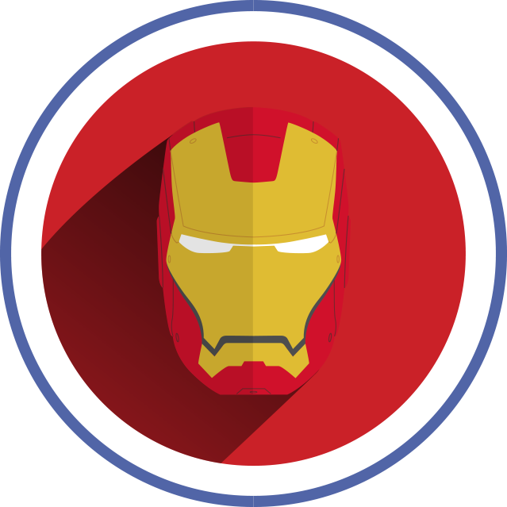

<p align="center"></p>

# ironman

A Claude Code mod for people who want to stay in the room.

## Why

ironman is a revolt against AI automation where you run a thousand agents and go away to sip coffee. You come back to a pile of code you never read.

It is for those who work like Tony Stark. AI and human work in close harmony, augmenting each other without losing focus.

ironman makes Claude work that way.

## What it does

- **Talks like a colleague, not a manual.** One idea per turn, plain words, and every technical term explained the first time it shows up. The turn always goes back to you.
- **Checks its own replies before you see them.** Each draft runs through a readability checker. If it finds undefined jargon or a reading grade above 9, Claude rewrites the draft first.
- **Never writes code you have not seen.** In code mode, Claude first shows the whole shape. Then it builds one block at a time: explain it, show it, wait for your yes, then write it.
- **Shows where you are.** A small band above the prompt shows that ironman is on and the current mode. A side pane shows the architecture diagram, then the plan, with the piece being built lit up.

## How it works

ironman has two parts.

**The skill** (`skills/ironman/SKILL.md`) holds the rules Claude follows. It has three modes:

| mode | what it is for |
|---|---|
| `discuss` | talking a problem through, like with a colleague |
| `teach` | learning something step by step, with checks that you followed |
| `code` | building something together, one approved block at a time |

Before each reply, Claude runs `scripts/check_draft.py` on its draft. The checker flags rare words and acronyms that were not explained, and prose above reading grade 9. Claude fixes what is flagged and sends the checked text. A reminder hook repeats this rule on every message. A Stop hook scores every reply and logs it to `~/.claude/ironman/log.jsonl`, and `/ironman report` sums the log up.

**The mod** (`hooks/`) changes what Claude Code shows on screen:

- `band.tsx` draws the band above the prompt: `ironman · code`, in the mode's color.
- `pane.tsx` adds a side pane and three tools Claude calls:
  - `pane_diagram` draws a mermaid diagram of the overall design, for the overview.
  - `pane_plan` replaces it with the plan: code blocks as boxes joined by arrows, or a lesson's steps as a list. Each item has a note you can open.
  - `pane_focus` lights up the item being worked on. Finished items get a check.

The pane is sized to fit the diagram.

## Install

In a terminal Claude Code session, type:

```
/plugin install ironman --marketplace cerebrai/ironman-mod
```

Answer `y` to add the marketplace, then pick the user scope. Start a new session and turn it on:

```
/ironman on code
```

If your Claude Code puts plugin skills under the plugin's name, use `/ironman:ironman on code`, or just say "ironman on".

### Requirements

- A Claude Code build with mod support (tested on 2.1.296).
- [`uv`](https://docs.astral.sh/uv/), which runs the readability checker.
- For diagrams: Node.js (for `npx`) and Chrome or Chromium. The mod looks for `/usr/bin/google-chrome`. If your browser is elsewhere, set `PUPPETEER_EXECUTABLE_PATH` to its path.
- For pictures in the pane: a terminal that shows Kitty graphics, such as Ghostty, kitty or WezTerm. Elsewhere the pane shows a one-line description of the diagram.
- Inside a terminal multiplexer, Claude Code may turn pictures off even when the multiplexer passes them through. If so, start Claude with `CLAUDE_CODE_FORCE_TERMINAL_IMAGES=1`.
- The pane docks beside the chat in the fullscreen layout. If you drag its edge, Claude Code remembers that width for every pane, and the pane stops resizing to fit diagrams. To undo it, remove `pluginPanes.dockColumns` from `~/.claude.json`.

## Commands

| command | what it does |
|---|---|
| `/ironman on [discuss\|teach\|code]` | turn ironman on for this session (default mode `discuss`) |
| `/ironman off` | turn it off |
| `/ironman mode <mode>` | switch mode |
| `/ironman check` | score Claude's last reply |
| `/ironman learn <words…>` | add words the checker should treat as known |
| `/ironman forget <words…>` | remove them again |
| `/ironman report [all]` | sum up the log for this session, or all sessions |
| `/pane` | open the side pane yourself |

ironman is per session. Turning it on in one session leaves the others alone.

## Repo layout

```
.claude-plugin/   plugin.json and marketplace.json
hooks/            the mod: register.tsx, band.tsx, pane.tsx, hooks.json
types/            types for the mod's saved state
assets/           mermaid style for the pane diagrams
skills/ironman/   the skill: SKILL.md, references/, scripts/, word list, config
docs/             the logo
```

## Development

Run it from a clone without installing:

```
claude --plugin-dir ./ironman-mod
```

Check the plugin and run the checker's tests:

```
claude plugin validate .
uv run --with textstat --with wordfreq python -m unittest skills/ironman/scripts/test_readability.py
```

## License

MIT. See [LICENSE](LICENSE).

ironman is a fan-made name for a working style. It is not affiliated with or endorsed by Marvel.
